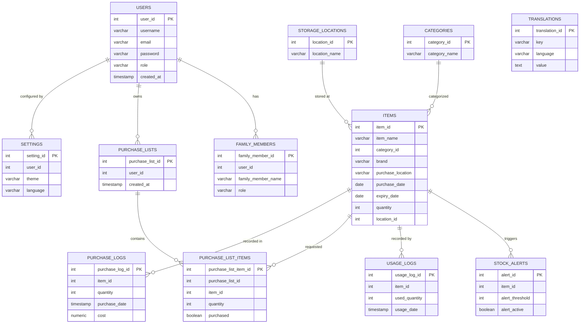

# Home Inventory System
이 프로젝트는 가정에서 생활용품 재고를 효과적으로 관리하기 위한 마이크로서비스 아키텍처(MSA) 기반의 시스템입니다. 개발 목적은 실제 사용 가능한 서비스를 개발하면서 동시에 스스로의 기술 연습을 위한 것입니다.
## Big Picture

- 1단계
  - Hexagonal 구조의 적용이 가장 큰 목적
  - 가장기본적인 기능 재고의 구입,사용제공
  - Port와 Adapter 정의
  - 재고수량변경은 사용자서비스에서 직접 처리
- 2단계
  - 분산이벤트 스트리밍 플랫폼을 통한 MSA 구조적용
  - 재고수량을 조절하는 재고관리서비스 추가

## 기능정의서

### 기능 정의서: 집안 재고 관리 프로그램

---

#### 1. **사용자 관리 기능**
- **1.1 사용자 등록 및 인증**
  - [ ] 사용자는 프로그램에 등록하고 로그인할 수 있습니다.
  - [ ] 이메일 또는 소셜 계정을 사용하여 인증합니다.
- **1.2 가족 구성원 관리**
  - [ ] 한 계정에 여러 사용자를 추가할 수 있습니다.
  - [ ] 가족 구성원 간의 재고 공유가 가능합니다.
- **1.3 사용자 권한 관리**
  - [ ] 관리자는 가족 구성원에게 다른 권한(읽기/쓰기/관리)을 할당할 수 있습니다.

#### 2. **물품 관리 기능**
- **2.1 물품 등록**
  - [x] 사용자는 물품의 이름, 카테고리, 브랜드, 구입처 등을 입력하여 물품을 등록할 수 있습니다.
  - [x] 등록한 물품은 수정, 삭제가 가능합니다
- **2.2 물품 정보 관리**
  - [ ] 각 물품의 세부 정보를 수정하거나 삭제할 수 있습니다.
  - [ ] 구매일과 유통기한을 입력하여 추적할 수 있습니다.
- **2.3 카테고리 분류**
  - [ ] 물품은 카테고리별로 정리되며, 사용자가 카테고리를 추가하거나 수정할 수 있습니다.
- **2.4 물품 검색**
  - [ ] 물품 이름, 카테고리, 보관 위치를 기준으로 물품을 검색할 수 있습니다.

#### 3. **재고 관리 기능**
- **3.1 재고 현황 조회**
  - [ ] 현재 보유 중인 물품의 재고 현황을 실시간으로 조회할 수 있습니다.
- **3.2 재고 알림 설정**
  - [ ] 재고가 일정 수준 이하로 떨어지면 사용자에게 알림을 제공합니다.
- **3.3 자동 재고 감소**
  - [ ] 사용자가 물품 사용을 표시하면, 해당 물품의 재고가 자동으로 감소합니다.
- **3.4 유통기한 관리**
  - [ ] 유통기한이 임박한 물품에 대한 알림을 설정할 수 있습니다.

#### 4. **구매 관리 기능**
- **4.1 구매 목록 생성**
  - [ ] 재고가 부족한 물품을 바탕으로 자동 구매 목록을 생성합니다.
- **4.2 구매 내역 기록**
  - [ ] 물품을 구매한 내역을 기록하며, 재고에 반영됩니다.
- **4.3 구매 알림**
  - [ ] 사용자는 구매해야 할 물품에 대해 알림을 받을 수 있습니다.

#### 5. **보관 위치 관리 기능**
- **5.1 보관 위치 등록**
  - [x] 주방, 냉장고, 창고 등 물품 보관 위치를 등록할 수 있습니다.
- **5.2 물품 보관 위치 관리**
  - [x] 각 물품의 보관 위치를 지정하고 이동할 경우 이를 업데이트할 수 있습니다.
- **5.3 보관 위치별 재고 조회**
  - [x] 특정 보관 위치에 있는 물품만을 필터링하여 조회할 수 있습니다.

#### 6. **보고서 및 분석 기능**
- **6.1 재고 보고서 생성**
  - [ ] 사용자는 특정 기간 동안의 재고 변화 및 사용 내역에 대한 보고서를 생성할 수 있습니다.
- **6.2 사용 패턴 분석**
  - [ ] 물품 사용 빈도를 분석하여, 재고 보충 주기와 구매 패턴을 예측합니다.
- **6.3 예산 관리**
  - [ ] 물품 구매에 사용된 비용을 추적하고, 예산을 관리할 수 있는 기능을 제공합니다.

#### 7. **모바일 및 알림 기능**
- **7.1 모바일 지원**
  - [ ] 프로그램은 스마트폰에서도 사용할 수 있도록 모바일 앱 또는 웹 앱을 제공합니다.
- **7.2 푸시 알림**
  - [ ] 재고 부족, 유통기한 임박, 구매 목록 추가 등의 상황에 대해 푸시 알림을 제공합니다.

#### 8. **데이터 백업 및 복구 기능**
- **8.1 자동 백업**
  - [ ] 재고 데이터와 설정을 주기적으로 자동 백업합니다.
- **8.2 데이터 복구**
  - [ ] 백업된 데이터를 통해 재고 정보를 복구할 수 있습니다.

#### 9. **시스템 설정 기능**
- **9.1 테마 및 사용자 인터페이스 설정**
  - [ ] 사용자는 프로그램의 테마와 인터페이스를 개인화할 수 있습니다.
- **9.2 다국어 지원**
  - [ ] 프로그램은 다양한 언어를 지원합니다.
#### 10. **재고 우선순위 기능**
- **10.1 재고 우선 순위 설정**
  -	[ ] 사용자는 재고 항목마다 우선 순위를 설정할 수 있습니다. 우선 순위는 숫자 또는 등급(예: A, B, C)으로 표현될 수 있습니다.
  -	[ ] 우선 순위는 재고의 중요성, 사용 빈도, 유통기한 임박 여부 등에 따라 자동으로 조정될 수 있습니다.
  -	[ ] 사용자는 우선 순위 기준을 직접 설정하거나 시스템 제안 기준을 사용할 수 있습니다.

